# ADR-011: Agent Persistence and Human-in-the-Loop

## Status

Accepted

## Context

ADR-010 introduced a parallel LangGraph troubleshooting path but deliberately deferred
checkpointing, persistence, durable execution, and human-in-the-loop (HITL). A
troubleshooting agent that proposes a write action needs a deterministic pause before the
action can occur. It must preserve enough orchestration state to resume the same run,
without allowing an LLM, a framework default, or a retry to bypass approval, model
routing, or model egress policy.

This changes long-lived runtime behavior and establishes a future persistence boundary.
It is therefore an architectural decision rather than a local implementation detail.

## Decision

### Native LangGraph Checkpointing

The LangGraph path uses LangGraph's native checkpointer abstraction. Each resumable run
is identified by the native configuration shape:

```python
{
    "configurable": {
        "thread_id": "...",
    },
}
```

The same `thread_id` identifies a continuation of one run; different IDs isolate their
checkpoint histories. For the local/demo runtime, `run_id` and `thread_id` have a stable
one-to-one relationship and use the same UUID value. A resume always reuses that value;
it never generates a replacement thread.

`InMemorySaver` is restricted to isolated deterministic tests. The production
pausable-agent path uses the official asynchronous `AsyncPostgresSaver` from
`langgraph-checkpoint-postgres`. Its framework-managed checkpoint tables are created by
the checkpointer's supported `setup()` lifecycle and are not replaced by project-owned
checkpoint tables or serializers.

No project-specific parallel thread, checkpoint, or polling abstraction is introduced.
### Durable PostgreSQL Runtime Persistence

The local demo uses the existing PostgreSQL instance but separates factory data from
agent runtime data through distinct PostgreSQL namespaces: the established factory-data
tables (currently in `public`) own production and document-catalog records;
`agent_runtime` owns application-managed run records; official
LangGraph checkpoint tables remain framework-managed in their dedicated configured
schema. Factory Data Persistence and Agent Runtime Persistence are separate concerns.

`agent_runtime.agent_runs` persists the public lifecycle and resume-binding context:
run/thread ID, status, request, effective classification, selected semantic model
profile, normalized tool-call summary, final answer when present, sanitized error
metadata, and lifecycle timestamps. It is implemented by an Infrastructure SQLAlchemy
2.x repository adapter. Retention is deliberately open.

For safe read-only runtime operations, the same project-owned record also persists a
minimal approval audit: the known action name, approval request timestamp, explicit
approve/reject decision, and decision timestamp. It never persists a new checkpoint
projection or exposes approval arguments, summary, or other free-text payload through
that operational projection.

The application role receives RLS protection for `agent_runtime.agent_runs` using the
existing transaction-local clearance context. Framework-owned checkpoint tables are not
altered with project RLS policies because that would risk framework compatibility. Their
access is bounded by a dedicated schema and least-privilege application role grants.

On resume, persisted classification and model-profile bindings MUST match the composed
agent. A mismatch, missing binding, classification downgrade, or execution-zone change
fails closed. Resume does not reroute and ADR-009 still validates every later model call.
Authentication remains open; the server-injected demo `SecurityContext` supplies the
current RLS clearance.

Checkpointed graph state is restricted to serializer-safe primitives and LangChain
message contracts. Project value types are restored only at the agent's public result
boundary, so a checkpointer does not depend on project-specific object deserialization.

### Native Interrupt and Resume

An action requiring human approval pauses a graph node through LangGraph
`interrupt(payload)`. The payload is a JSON-serializable structured request with a
stable `kind`, action name, and only the details necessary for a person to decide.

The caller resumes the same `thread_id` with `Command(resume=...)`. The first slice
accepts only the explicit values `approve` and `reject`; invalid values fail
deterministically and do not execute the action. The agent must not implement its own
waiting loop around approval.

### Deterministic Approval Boundary

Approval requirements are deterministic capability policy, not an LLM judgment:

* Read capabilities `get_product_history` and `get_machine_status` execute normally.
* The action capability `create_maintenance_ticket` always requires approval.

The LLM may propose a known action through its existing tool-choice responsibility, but
it cannot decide whether that action needs approval. The local Factory-MCP action is
durably persisted in PostgreSQL; it does not control equipment or call an external
ticketing system.

### Side Effects and Idempotency

LangGraph restarts an interrupted node from its beginning when it receives a resume
command. Therefore, code before `interrupt()` must be pure or idempotent. The approval
node only validates and constructs data before interrupting. The write action executes
only in a separate node after an approved resume.

Each independently proposed action receives a server-generated UUID before the approval
interrupt. It remains stable in the pending-action checkpoint across resume/retry. The
model's tool-call/action ID is correlation data, not sufficient execution identity. The
application persists the UUID and immutable run/action/target/profile/classification
binding in `agent_runtime.agent_runs.approval_generations`, under the existing run RLS.
Store-only proposals mint their own UUID; a payload cannot choose its generation. The
graph supplies its checkpointed UUID through an explicit server-only store parameter.
Re-persisting that same proposal preserves its decision and consumption state; rebinding
the UUID to different arguments is denied.

```mermaid
flowchart LR
    R[Run] --> P[Server-generated proposal UUID]
    P --> H[Human sees generation G]
    H --> U[UI retains G with displayed proposal]
    U --> D[Approve or reject request includes G]
    D --> V[Atomic resume guard compares current generation with G]
    V --> A[Decision persisted for generation G]
    A --> C[Atomic single-use execution claim for G]
    C --> K[SHA-256 of run ID and generation UUID]
    K --> T[Unique maintenance-ticket request ID]
```



The bounded public approval DTO exposes the existing `approval_execution_id` UUID as an
opaque concurrency token. Both approve and reject requests must include the exact UUID
shown with that proposal; missing or malformed tokens fail closed. The browser retains
the token with the displayed approval and never fetches a newer token to apply an old
decision. The token is not authorization: authentication, classification visibility,
clearance, capability permissions and execution authorization remain independent.

The public run store atomically compares that expected `approval_execution_id` with the
current pending generation while claiming the waiting run, under the same database row
lock or in-memory lock as the decision update. A mismatch or already-decided generation
returns a neutral HTTP 409 conflict without changing any decision or executing the graph.
An inaccessible run retains its existing neutral denial before the generation conflict.
The UI invalidates stale approval controls, reloads authoritative state and requires a
new explicit decision; it never retries or transfers the old intent to the new action.
The same UUID therefore binds human-visible proposal, decision request, persisted
decision, execution claim and ticket idempotency. Model `action_id` remains correlation
only; `approval_execution_id` is the authoritative approval-generation identity.

The public run store atomically claims a waiting run before resuming the graph. Protected
execution checks the exact generation and consumes it once under the database row lock
(or the development store lock). A different approval generation remains distinct even
with identical model IDs, targets, or summaries. PostgreSQL retains the existing unique
ticket request-ID constraint as the second duplicate-write defense. At most one approval
is pending per run; a previously claimed operation may finish while a later generation
is approved.

A ticket retry cannot consume or execute the generation again. It may return the
already-created ticket only after the same persisted consumed-generation binding and
current clearance have been checked, followed by an RLS-backed request-ID lookup. If no
ticket exists, it fails closed rather than retrying a side effect. Calibration replay
remains denied. Approval consumption still precedes side-effect creation in separate
transactions; this is not a transactional outbox or a claim of crash-proof execution.
Legacy approvals lacking authoritative generation history fail closed. Migration 0025
adds empty history without inferring or authorizing legacy generations.

### MCP Execution Authorization

MCP tool permission grants capability access only; it does not authorize a side effect.
Both direct MCP calls and post-HITL graph calls converge on the executing capability's
authoritative persisted action claim. No protected execution occurs without that claim.
The claim checks the current principal's run/resource clearance, the persisted action
profile and classification, an approved running run, decision timestamp and approver
clearance, the exact action ID, and its bound arguments. Ticket approval binds station
and summary; calibration approval binds station, device, and operation. Missing,
unrelated, rejected, or inaccessible approvals produce bounded neutral denial. A consumed
generation cannot authorize another side effect; only the bound existing-ticket retry
described above may resolve idempotently.
Run and action IDs are lookup references, never proof of approval. The graph injects
them from trusted run and checkpoint state after an approved resume; the model never
owns them. Existing PostgreSQL RLS and row locking enforce the resource and single-use
boundaries. PUBLIC MCP principals have read-only capability permissions. Hardware
preparation is read-only and does not require an execution approval.

### Security and Model Routing

ADR-009 remains binding before every model call, including calls made after an approved
action. Checkpoints and resumes do not authorize egress, change data classification, or
create a cloud fallback. Sensitive state is not unnecessarily copied into interrupt
payloads or logs.

ADR-008 remains binding. The Composition Root selects the semantic Model Profile before
constructing a run. The selected profile and run classification are persisted as minimal
run context and must match when resuming. A resume never reroutes or upgrades a model.

### Scope

This ADR does not select a retention policy, authentication mechanism, web approval UI,
external ticketing API, PLC action, background workflow, LangSmith, MCP, multi-agent
topology, subgraphs, or planner.

## Alternatives Considered

### 1. Keep all runs synchronous and do not support HITL

Rejected. It cannot safely demonstrate a meaningful action boundary or continuation.

### 2. Implement a project-specific checkpoint store and approval wait loop

Rejected. It duplicates LangGraph behavior, creates a second lifecycle abstraction, and
would make future framework integration harder to reason about.

### 3. Let the LLM decide whether approval is required

Rejected. Approval is deterministic safety and authorization policy; an LLM is not a
trusted enforcement mechanism.

### 4. Use native LangGraph checkpoints, `interrupt()`, and `Command(resume=...)`

Accepted. It directly expresses pause/resume semantics while retaining project-owned
policy, capabilities, routing, and egress enforcement.

### 5. Use PostgreSQL-backed official LangGraph checkpointing and an AgentRun store

Accepted. Process-restart resume, API run history, and HITL continuation are now concrete
runtime requirements. The official framework saver preserves LangGraph compatibility,
while a separate SQLAlchemy adapter persists application-owned lifecycle records.

## Consequences

### Guardrail Clarification

The persisted pending action is a strict Pydantic contract. For
`create_maintenance_ticket`, the model never owns `run_id`, `request_id`, or an idempotency key;
the post-approval execution node uses the checkpointed server-generated approval UUID. The
database repository's unique request ID remains the second idempotency defense for a
duplicate or concurrent resume. A reject clears the pending action and never executes it.

Positive:

* the graph can pause and continue a single run deterministically
* write actions are separated from read tools and require explicit approval
* action execution cannot occur before approval
* the project gains practical LangGraph checkpoint and interrupt experience
* process and application-store recreation retain run history and framework checkpoints

Negative:

* callers must retain and reuse `thread_id` for a continuation
* interrupted graph nodes need careful side-effect placement
* the local demo needs PostgreSQL before it can start a pausable runtime
* the parallel LangGraph path gains lifecycle behavior not present in the manual
  reference path

## Relationship to Existing Decisions

ADR-003 keeps persistence adapters outside the Core and requires explicit composition.
ADR-004 continues to govern the bounded sequential tool behavior. ADR-005 requires
deterministic tests for approval, rejection, replay, and isolation. ADR-008 owns initial
deterministic model selection; ADR-009 owns security eligibility and final egress.
ADR-010 owns LangGraph orchestration migration; this ADR implements its deliberately
deferred checkpointing and HITL boundaries for the parallel path only.

## Agent Run Profile Refinement

Every durable run also persists its server-resolved `run_profile`. The profile and
effective classification form one immutable resume binding alongside the selected
semantic model profile. Resume reconstructs the profile through deterministic policy
and rejects a profile, classification, MCP identity/scope, or model-profile mismatch
before resuming the checkpoint. `INTERNAL_DIAGNOSTIC` has no write tool and therefore
cannot create an approval interruption; existing confidential HITL behavior is
unchanged.
