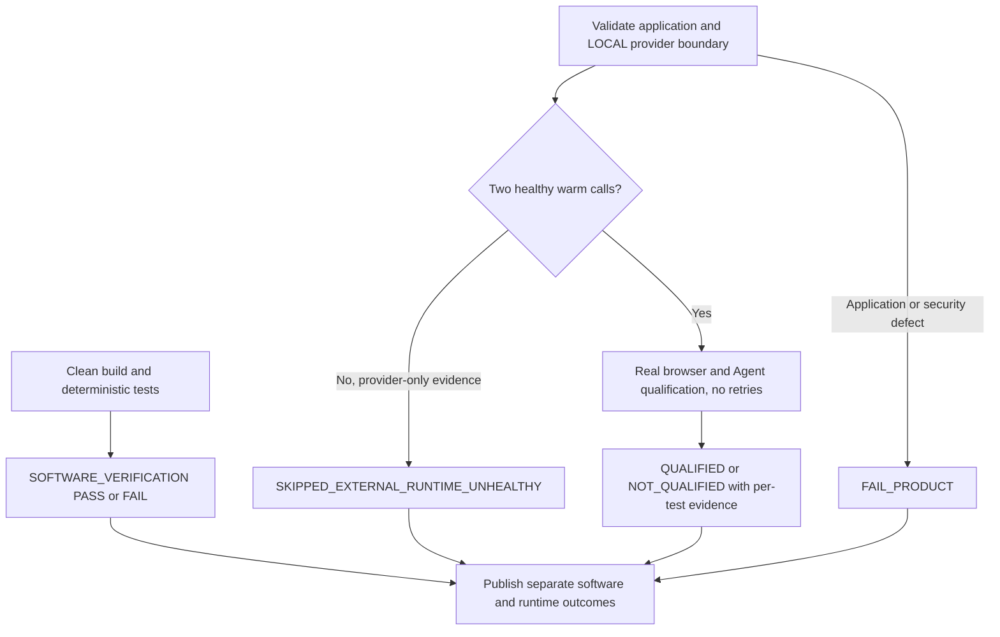

# ADR-021: Release Software Verification and Local Runtime Qualification

## Status

Accepted — 2026-10-18. Refines ADR-005; production execution policy is unchanged.

## Context

SANITY-01 demonstrated recurrent local Ollama inference deadlines after deterministic
security and application regressions passed. A single release Boolean confused
software correctness with qualification of a particular workstation's AI runtime.
Neither a provider failure nor a skipped runtime measurement proves software failure
or complete deployment qualification.

## Decision

`SOFTWARE_VERIFICATION` is mandatory and independent of Ollama inference speed.
It includes clean application builds, complete deterministic backend/integration,
Knowledge deployment, frontend, safe browser, legacy browser, twelve Agent journeys,
reference contracts and historical regressions. Test-only scripted provider responses
enter at the provider transport boundary. Real API, authentication, run policy,
model authorization, SDK serialization, LangGraph, MCP, PostgreSQL RLS, persistence,
documents and delivered frontend remain active. Test compositions cannot be selected
by a production request or production configuration.

`LOCAL_RUNTIME_QUALIFICATION` remains a real browser/Agent/MCP/Ollama/embedding
measurement with the unchanged production model and deadlines. Before journeys,
validate application configuration, LOCAL selection, authorization/readiness and
placement; perform at most one necessary warmup and two measured warm calls.
Both measurements must finish in less than 20 seconds and generate at least
20 native tokens/s. A skip requires positive evidence of a valid request reaching
the selected local provider and failed health criteria, with no preceding application,
authentication, RLS or security failure. Its sole reason code is
`EXTERNAL_LOCAL_PROVIDER_UNHEALTHY`; its outcome is
`SKIPPED_EXTERNAL_RUNTIME_UNHEALTHY`, never PASS.

After healthy preflight, a correlated SDK `APITimeoutError` and matching Ollama
latency/cancellation can classify an affected test `BLOCKED_BY_LOCAL_PROVIDER`.
Qualification is then `NOT_QUALIFIED`. Missing tools, wrong targets, response or
persistence errors, missing evidence without provider proof, application exceptions
and security failures remain `FAIL_PRODUCT`; they take precedence over provider
classification. Generic exceptions cannot authorize an environmental skip.

`SOFTWARE`, `LOCAL_RUNTIME` and `FULL` commands publish the two outcomes separately.
FULL executes software then runtime, retains first evidence and never retries a
failed journey. Unexecuted required assertions cannot pass. A software PASS plus
an unqualified or skipped runtime must never be described as a fully qualified
deployment. Missing deterministic infrastructure fails the software gate; only
explicit platform limitations, separately executed opt-ins and protected MANUAL_ONLY
claims may be excluded, with exact reasons and denominators.

## Verification flow

## Alternatives considered

- Raising deadlines or retrying: changes production behavior and hides first failures.
- Removing live tests: loses real runtime and model-behavior qualification.
- Mocking final HTTP results: bypasses the application guarantees being verified.
- Treating every timeout as external: can hide application and security defects.

## Consequences

Both suites and their assertion mappings must stay synchronized. Scripted responses
prove contract handling, not natural-language model quality. Software Knowledge
deployment may substitute deterministic embedding transport in isolated infrastructure;
real embedding placement and inference remain runtime qualification claims. Cached
OCR/layout/reranking and offline deployment contracts remain separately exercised.
No new provider fallback, retries, production model, prompt or timeout is introduced.
