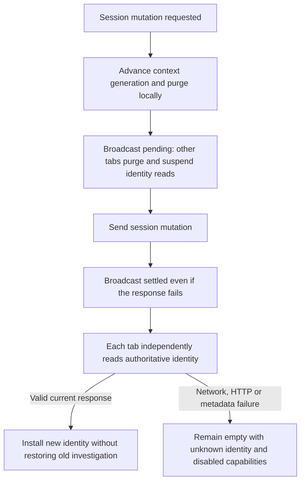

# Browser Demo Authentication

## Demo Users

**DEMO-ONLY CREDENTIALS — NOT FOR PRODUCTION OR SERVICE AUTHENTICATION**

The canonical configuration is [config/demo-users.toml](../../config/demo-users.toml).
The server loads it only when `DEMO_AUTH_MODE=true`. These credentials are intentionally
public demo credentials and are not secrets. They authenticate only predefined local
browser demo identities. Database, MCP, API bearer, service, provider, telemetry and
infrastructure credentials remain secret and are not covered by this exception.

| Username | Password | Clearance | Roles | Purpose |
| --- | --- | --- | --- | --- |
| demo-public | demo-public | PUBLIC | — | Public demo data |
| demo-internal | demo-internal | INTERNAL | — | Internal demo data |
| demo-confidential | demo-confidential | CONFIDENTIAL | — | Confidential troubleshooting |
| demo-restricted | demo-restricted | RESTRICTED | — | Restricted demo data |
| demo-admin | demo-admin | PUBLIC | MODEL_ADMIN | Model administration |

Quick switch intentionally lets the local browser user assume **every predefined demo
identity**, including admin, without entering a password. This accepted demo trust model
is not an authentication bypass. `demo-admin` does **not** imply higher data clearance:
it cannot read confidential/restricted data merely because of its role. A restricted user
has no model-administration permission. Allowing either of those boundary violations,
exposing service credentials, or enabling quick switch outside demo mode would be a defect.

## Session and UI Contract

Start the supported Compose stack with `DEMO_AUTH_MODE=true` in `.env`. Open
`http://localhost:8080`; a fresh browser session automatically starts as `demo-public`.
There is no native Basic dialog, password-file mount, or gateway token injection.
An existing valid demo session survives refresh. Logout stays logged out on refresh;
use the compact demo-user list to log in again without typing credentials. Explicit
username/password testing remains available through the existing `/login` API.

The top-right header contains Monitoring, Configuration and an account button with the current
username. The account menu shows clearance, roles, language, Switch user and Logout.
Switch user lists all configured identities and marks the active user. Configuration
is enabled only for the server-derived MODEL_ADMIN role; a restricted user's higher
clearance does not enable it. The Investigation toolbar contains only PDF and New Chat.
Language changes preserve identity and investigation. Account controls
support keyboard use, outside-click dismissal and Escape; passwords are not rendered.

The browser retrieves safe identity metadata from `GET /api/v1/auth/me`: username,
clearance and roles only. `GET /api/v1/auth/config` exposes the demo-mode flag and safe
user metadata; passwords and session IDs are excluded. Session mutations use
`POST /api/v1/auth/bootstrap`, `/switch`, `/login` and `/logout`, with the same-origin
`X-Demo-Session: 1` header. Wrong passwords and unconfigured identities are denied.
Cross-origin/Fetch-Metadata mutations are rejected. No browser request supplies
`user_clearance`; session-authenticated APIs reject that obsolete field. Direct bearer
API clients retain their existing optional clearance narrowing for compatibility.

Switch/logout invalidates frontend context generation, aborts pending requests, clears
conversation/drafts/investigation references/export state, revokes Blob URLs and closes
the model dialog **before** mutating the session. Late JSON/binary results are discarded.
Object URLs for transcript-only browser PDFs share the API module's existing
context-owned document URL registry with server PDF and document downloads. Context
invalidation revokes them synchronously, independently of identity refresh; stale
export generations cannot publish a URL or start a download. The existing 60-second
cleanup remains a secondary mechanism for normal same-context exports. Language-only
preference changes do not invalidate that owner.
An identity switch starts a new investigation; it does not automatically restore the previous identity's history. Demo investigations
remain shared by classification, not private per-user tenants. Explicit reads under the
new identity may succeed when its clearance authorizes the data. Refresh and BFCache restoration verify the current server identity and authorize
saved references again. The model-configuration button is visible but disabled without
MODEL_ADMIN; backend enforcement remains authoritative even for manually crafted requests.

## Server Boundary and Limits

The API creates a normal `SecurityContext` from the canonical identity. The public role
MODEL_ADMIN maps to the existing core `model-admin` role; the adapter retains the technical
`demo-user` baseline required by the core context contract. That baseline grants no admin
permission. Ownership, PostgreSQL RLS, classification, model/embedding egress and persisted
action-bound HITL claims continue through their existing authorization paths.

Session IDs are random opaque HttpOnly, SameSite=Strict cookies scoped to `/api/`.
The process-local registry holds at most 4096 sessions with an eight-hour TTL. Switch and
logout revoke the previous session; API restart expires sessions. This single-process,
loopback HTTP demo does not provide durable/multi-worker sessions, remote TLS or production
OIDC. With `DEMO_AUTH_MODE=false`, demo session endpoints/identity switching are unavailable;
the browser shows that demo authentication is disabled. Direct service bearer APIs remain
available. A production browser authentication design is deliberately outside this task.

See [ADR-013](../decisions/ADR-013-fastapi-application-boundary.md). ADR-015 continues to
govern the separate MCP bearer identity/permission boundary.

Shared-session invalidation is independent of identity metadata refresh. Before dispatching
a session mutation, the sender purges through the existing context-generation boundary and
broadcasts `SESSION_INVALIDATED` with an opaque client operation ID and `pending` phase.
Receivers immediately purge through the same boundary and wait for pending mutations to
settle before reading identity. The sender broadcasts `settled` even after network,
HTTP or response-parsing failures: once dispatched, the session may have changed.
Client validation that prevents dispatch sends no invalidation. Conservative purging for
a server-rejected request is harmless; it never restores the previous investigation.

No notification depends on successful `/auth/me`. Receivers clear investigation/chat,
references, pending approvals and their generation tokens, requests, Blob/download and
PDF/export state, and identity-sensitive dialogs before attempting refresh. Language may
survive. Unknown identity grants no usable data context or MODEL_ADMIN capability. A local
auth revision and the existing request generation prevent late identity/results/errors from
overwriting newer state. Duplicate or out-of-order notifications are idempotent; operation
IDs correlate invalidations and never authorize server access. Messages carry no identity,
conversation, credentials or approval token.

The owned BroadcastChannel closes on pagehide and reconnects on pageshow. A mutation
settling after pagehide sends its completion through a short-lived channel that closes
immediately, so closure does not suppress invalidation. The existing
synchronous pagehide purge removes protected DOM before BFCache entry; pageshow revalidates
server identity before saved-reference restoration. Missed pending notifications are cleared
on BFCache restoration so reconciliation does not depend on delivery while frozen. No shared
storage epoch is required. Initial loading checks `/auth/me` before bootstrapping a missing
session, so opening another tab with a valid cookie does not unnecessarily mutate that session.
Browsers without BroadcastChannel retain refresh/BFCache revalidation; live cross-tab purge
requires BroadcastChannel. No bounded auth-fetch timeout is currently configured.

Server-owned operation scopes may narrow the identity ceiling: structured diagnostics
require at least INTERNAL before target lookup and retain their INTERNAL RLS scope,
including for higher-clearance identities. PUBLIC and demo-admin cannot invoke them.
